# Glossary and geometry catalog

What the words mean in this project today, and what geometry the compiler
can build. Pictures and numbers come from the current compiler on the bench
specs (`tools/research/geometry_catalog.ts`, 41 rides). Updated 2026-11-01.

## Glossary

| word | meaning |
|---|---|
| **impact** (beat, contact) | A moment in the spec where the rider should hit something, with a requested strength from 0 to 1. |
| **gap** | Everything between two consecutive impacts. The compiler builds one piece of geometry per gap; the code calls it a *section*. |
| **geometry** (family) | The kind of line built for a gap: arcs, fold, S-sweep, ripples, terraces or scattered (below). |
| **shape** | Any geometry other than plain arcs and scattered. |
| **upper rail** (guide) | An optional second line above the main line, which can catch or steer the rider. |
| **offered / forbidden** | A gap either offers an upper rail (the search builds it only where it helps) or forbids one. Since 2026-11-01 nothing *requires* a rail. |
| **plan** | Before the search, the compiler groups consecutive gaps into phrases of 2–3, splitting at musical boundaries and changes of mood. It draws one geometry per phrase at random, by weight (below). The seed fixes the draw. The plan is the only source of variety. |
| **fallback** | If a shaped gap reaches a dead end (no candidate geometry lands the next impact), the search retries that gap with plain arcs before backtracking. |
| **squeezed shape** | A shape kept in a very short gap (under 9 frames, about 0.2 s), where the old rule would have used arcs. It happens only on very fast specs. |
| **rail hand-over** (transfer) | A layout where the rider leaves the main line and lands on the upper rail. It is no longer drawn by the plan; V6's fixed cases still ask for it. |
| **ride-out** | Long riding on geometry, as opposed to bouncing off it. It goes with low air. |
| **seed** | Fixes the plan's draws and the search's random choices. The same spec and seed give the same ride. |
| **headline** | The production grade: 1000·exp(−rms/0.25) over the air, speed and impact errors, with an incomplete ride counting 0. 739 means an error of 0.076; 800 means 0.056. |
| **V6** | The previous benchmark (frozen 2026-10-01), now only a regression check (`npm run sentinel`). |
| **V7** | The benchmark being built now. |
| **reference / candidate** | In `npm run compare`: the compiler we compare against (a named commit), and the one being tried. |
| **arm** | One compiler (by content) under one setting (allowance, creative preferences). The saved rides of a candidate or reference. |
| **round** | Every spec's k-th seed. A comparison runs round by round, so a stopped run covers the suite evenly. |
| **confirmation seeds** (fresh seeds) | The same specs at seeds never used while developing. |
| **reserve specs** (sealed) | Specs written but kept out of development, run to confirm. Each use wears them out. |
| **held-out songs** | Trouble, Valhalla, Circus Minimus: run only at decision points, never to tune. |

## The six geometries

Each picture shows one gap as the compiler built it. The main line is dark,
the upper rail red, the rider's path through the gap dotted blue, and the
next gap's start grey. The rider rides the geometry, leaves it, and flies to
the next impact. In a typical 0.9 s gap the geometry is the launch, not the
whole gap.

| geometry | how it is built | ride time | rail used when offered |
|---|---|---|---|
| **Arcs** | One smooth curve. The original geometry. | 44% | 56% (offered in about a quarter of arc gaps) |
| **Scattered** | Separate short fragments instead of one connected line. | 15% | 60% |
| **Terraces** | Steps: the heading rises and falls twice along the gap. | 12% | 83% |
| **Ripples** (scallops) | A gentle wave, one cycle. | 11% | 85% |
| **Fold** | Three straight faces with two sharp corners. | 9% | 90% |
| **S-sweep** (serpentine) | One S-shaped bend. | 9% | 79% |

| | upper rail used | no rail |
|---|---|---|
| Arcs | 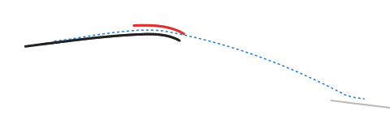 | 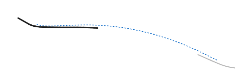 |
| Fold | 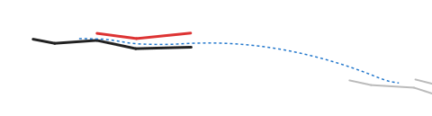 | 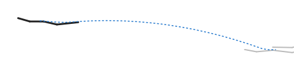 |
| S-sweep | 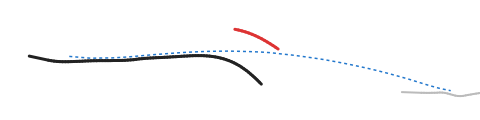 | 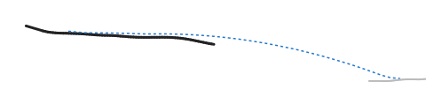 |
| Ripples | 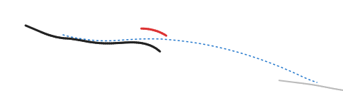 | 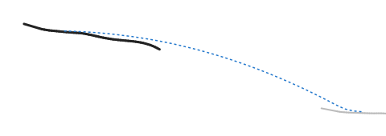 |
| Terraces | 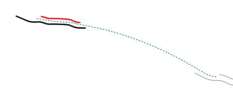 | 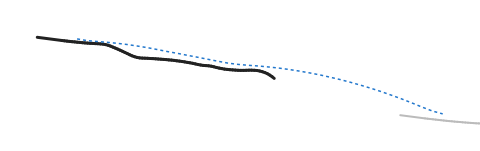 |
| Scattered | 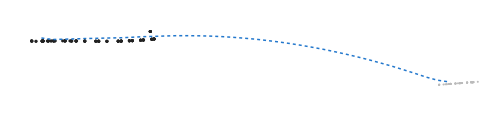 | 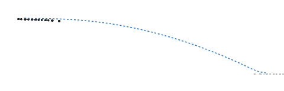 |

A shape is checked after the ride: a fold needs its two corners, and any
other shape needs two turn reversals. A shaped gap that fails the check is
rejected like a missed impact.

## When the compiler uses which

The plan draws one geometry per phrase (2–3 gaps), with these weights in an
ordinary passage. A calm passage shifts weight toward plain arcs without a
rail and away from scattered:

| choice | weight |
|---|---|
| plain arcs, no rail | 30% |
| plain arcs, rail offered | 11% |
| each shape (fold, S-sweep, ripples, terraces), rail offered | 11% each, 44% together |
| scattered | 15% |

The same choice twice in a row is made four times less likely. The
geometry's own size and bend are then found by the search, together with the
landing.

Explicit requests (V6's fixed cases) can instead ask for a given geometry on
given gaps, including a required rail or a rail hand-over.
